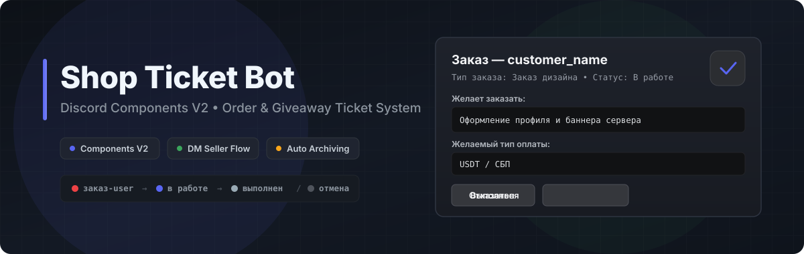
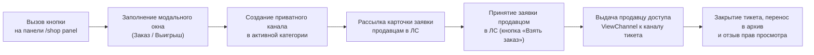
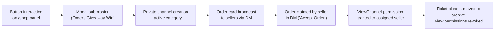

<div align="center">



<br />

[](https://nodejs.org/)
[](https://discord.js.org/)
[](https://discord.com/developers/docs/Action)
[](./LICENSE)

<p align="center">
  <strong>Discord-бот для приёма заказов и выдачи призов розыгрышей на базе Components V2</strong><br />
  <sub>Discord ticket bot for managing shop orders and giveaway prizes built with Components V2</sub>
</p>

<p align="center">
  <a href="#документация-ru"><kbd>Документация (RU)</kbd></a>
  &nbsp;&nbsp;
  <a href="#documentation-en"><kbd>Documentation (EN)</kbd></a>
</p>

</div>

---

<a id="документация-ru"></a>

## Документация (RU)

**Shop Ticket Bot** — Discord-бот для обработки заказов и выдачи призов розыгрышей через приватные текстовые каналы (тикеты) и личные сообщения (ЛС) продавцов. Интерфейс построен на контейнерах **Discord Components V2**. Логика работы, подписи кнопок, поля форм и шаблоны сообщений настраиваются в едином файле [`config.md`](./config.md).

### Содержание

| Раздел | Описание |
| :--- | :--- |
| **[1. Архитектура и логика работы](#1-архитектура-и-логика-работы)** | Схема обработки заявки от нажатия кнопки до архивации |
| **[2. Структура репозитория](#2-структура-репозитория)** | Состав файлов и назначение модулей |
| **[3. Требования и права в Discord](#3-требования-и-права-в-discord)** | Необходимые интенты, скоупы и права роли бота |
| **[4. Установка и запуск](#4-установка-и-запуск)** | Команды развёртывания и проверки синтаксиса |
| **[5. Переменные окружения (`.env`)](#5-переменные-окружения-env)** | Параметры подключения, ролей и категорий |
| **[6. Команды и матрица доступа](#6-команды-и-матрица-доступа)** | Доступность слэш-команд для менеджеров и продавцов |
| **[7. Статусы и именование каналов](#7-статусы-и-именование-каналов)** | Префиксы каналов и правила изменения прав доступа |
| **[8. Конфигурация в `config.md`](#8-конфигурация-в-configmd)** | Синтаксис `config.md` и таблица переменных шаблонизатора |

---

### 1. Архитектура и логика работы



1. **Панель заявок (`/shop panel`)**: публикует в выбранном текстовом канале контейнер с баннером (`Assets/test.png`) и двумя кнопками: оформление заказа и получение выигрыша.
2. **Валидация и форма**:
   - Перед открытием модального окна проверяется наличие открытого тикета у пользователя (допускается только один активный тикет на пользователя).
   - Форма заказа запрашивает описание задачи и способ оплаты.
   - Форма выигрыша запрашивает сервер проведения розыгрыша и описание приза.
3. **Создание канала и уведомление продавцов**:
   - В категории активных заказов создаётся текстовый канал с доступом только для заказчика. В канал отправляется контейнер с кнопкой отмены.
   - Всем участникам сервера с ролью из `SELLER_ROLE_IDS` отправляется ЛС с данными заявки и кнопкой принятия.
4. **Назначение исполнителя и закрытие**:
   - При нажатии кнопки принятия в ЛС продавцу выдаётся право `ViewChannel` в канале тикета, а у остальных продавцов кнопка принятия блокируется.
   - У назначенного продавца в ЛС становятся доступны кнопки завершения и отказа.
   - При завершении, отказе продавца или отмене заказчиком канал переименовывается, переносится в архивную категорию, права `ViewChannel` для заказчика и продавца отзываются, а статистика сохраняется в `data/tickets.json`.

---

### 2. Структура репозитория

```text
shop-ticket-bot/
├── Assets/
│   ├── banner.svg        # Обложка репозитория
│   └── test.png         # Баннер панели /shop panel
├── src/
│   ├── config.js         # Парсер config.md и чтение переменных из .env
│   ├── customIds.js      # Генерация и разбор customId компонентов (префикс stb)
│   ├── storage.js        # Чтение/запись data/tickets.json и агрегация статистики
│   ├── tickets.js        # Управление каналами, правами доступа и жизненным циклом тикетов
│   └── ui.js             # Сборка контейнеров Discord Components V2 и WebP-оптимизация баннера
├── .env.example          # Шаблон переменных окружения
├── .gitignore            # Правила исключения файлов для Git
├── config.md             # Единый файл настройки логики, кнопок, форм и шаблонов контейнеров
├── index.js              # Точка входа, регистрация команд и обработчики событий Discord
├── LICENSE               # Лицензия MIT
└── package.json          # Зависимости и скрипты запуска
```

Директория `data/` и файл `data/tickets.json` создаются автоматически при работе бота.

---

### 3. Требования и права в Discord

* **Среда выполнения**: Node.js `>= 18.0.0`.
* **Настройки в [Discord Developer Portal](https://discord.com/developers/applications)**:
  - Раздел **Bot → Privileged Gateway Intents**: должен быть включён `Server Members Intent` (используется для получения списка участников с ролью из `SELLER_ROLE_IDS`).
  - Раздел **OAuth2**: приглашение бота на сервер со скоупами `bot` и `applications.commands`.
* **Необходимые права роли бота на сервере**:
  - `Manage Channels`
  - `Manage Roles` (`Manage Permissions`)
  - `View Channel`
  - `Send Messages`
  - `Attach Files`
  - `Read Message History`

---

### 4. Установка и запуск

```bash
git clone https://github.com/your-username/shop-ticket-bot.git
cd shop-ticket-bot

npm install
cp .env.example .env

npm run check
npm start
```

---

### 5. Переменные окружения (`.env`)

| Переменная | Обязательно | Назначение |
| :--- | :---: | :--- |
| `TOKEN` | Да | Токен Discord-бота. |
| `GUILD_ID` | Да | ID целевого Discord-сервера. |
| `MANAGER_USER_IDS` | Да | Discord ID пользователей-менеджеров через запятую. Полный доступ к `/shop panel` и `/shop stats`. |
| `SELLER_ROLE_IDS` | Да | ID ролей продавцов через запятую. Получение заявок в ЛС, управление заказами, доступ к `/shop stats`. ID сервера (`@everyone`) игнорируется. |
| `ACTIVE_ORDERS_CATEGORY_ID` | Нет | ID категории активных тикетов. При отсутствии значения категория ищется по имени из `config.md` (`categories.activeName`) или создаётся автоматически. |
| `ARCHIVE_ORDERS_CATEGORY_ID` | Нет | ID категории архивных тикетов. При отсутствии значения категория ищется по имени из `config.md` (`categories.archiveName`) или создаётся автоматически. |
| `REVIEWS_CHANNEL_URL` | Нет | URL канала отзывов. Если задан, подставляется в уведомление заказчику при завершении заказа. |

---

### 6. Команды и матрица доступа

Слэш-команды регистрируются для сервера `GUILD_ID` при событии `ClientReady`.

| Команда | Аргументы | Доступ | Действие |
| :--- | :--- | :--- | :--- |
| `/shop panel` | `channel` *(необязательно)* | `MANAGER_USER_IDS` | Публикация контейнера панели заказов в указанном или текущем текстовом канале. |
| `/shop stats` | — | `MANAGER_USER_IDS`, `SELLER_ROLE_IDS` | Вывод сводной статистики (всего, ожидают, в работе, выполнены, отказ продавца, отмена заказчика). |

---

### 7. Статусы и именование каналов

Формат имени канала: `{statusEmoji}{separator}{base}-{username}`.

| Статус в хранилище | Канал заказа | Канал выигрыша | Изменения в правах и расположении |
| :--- | :--- | :--- | :--- |
| `new` | `🔴・заказ-username` | `🔴・выигрыш-username` | Создаётся в активной категории. `ViewChannel` разрешён только заказчику. |
| `accepted` | `🔵・заказ-username` | `🔵・выигрыш-username` | Продавцу, принявшему заявку, добавляется право `ViewChannel: true`. |
| `completed` | `🔘・заказ-username` | `🔘・выигрыш-username` | Канал переносится в архивную категорию. Для заказчика и продавца устанавливается `ViewChannel: false`. |
| `declined` / `cancelled` | `⚫・заказ-username` | `⚫・выигрыш-username` | Канал переносится в архивную категорию. Для заказчика и продавца устанавливается `ViewChannel: false`. |

---

### 8. Конфигурация в `config.md`

Все параметры поведения, подписи компонентов и шаблоны контейнеров находятся в файле [`config.md`](./config.md) и загружаются модулем [`src/config.js`](./src/config.js) при старте процесса.

#### Формат записей в `config.md`

1. **Однострочные параметры** (переключатели логики `workflow.*`, команды, названия категорий, префиксы каналов, подписи и стили кнопок, поля и лимиты модальных окон) задаются элементами списка:
   ```markdown
   - `workflow.autoAcceptOnManagerMessage`: false
   - `workflow.archiveCompletedTickets`: true
   - `labels.orderButton`: Заказать дизайн
   - `buttons.panelStyle`: Secondary
   ```
   Допустимые значения стилей кнопок (`buttons.*`): `Primary`, `Secondary`, `Success`, `Danger`.

2. **Многострочные шаблоны контейнеров** задаются заголовком `### [имя_шаблона]` и блоком кода ```` ````markdown ````:
   ````markdown
   ### [customerTicketOrder]
   ````markdown
   # {username}, ваш заказ создан!
   > ***Обсудите детали заказа здесь: {channelUrl}***
   ## *Если вы передумали, нажмите кнопку ниже!*
   ````
   ````

#### Переменные шаблонизатора

| Переменная | Контекст использования | Значение |
| :--- | :--- | :--- |
| `{username}` | Тикеты, карточки в ЛС, ответы | Имя пользователя заказчика |
| `{userId}` | Карточки в ЛС, сообщения в канале | Discord ID заказчика |
| `{sellerId}` | Карточки в ЛС, уведомление о принятии | Discord ID продавца, принявшего заявку |
| `{channelUrl}` | Сообщения тикета, ответы модальных окон | Полная ссылка на канал тикета |
| `{channelId}` | Уведомления о панели и тикетах | ID канала |
| `{orderNumber}` | Шаблоны тикетов | Номер заявки |
| `{orderType}` | `sellerDmOrder` | Значение `labels.orderType` или `labels.wonType` |
| `{request}` | `sellerDmOrder`, `sellerCancelNoticeOrder` | Содержимое поля описания заказа |
| `{payment}` | `sellerDmOrder`, `sellerCancelNoticeOrder` | Содержимое поля способа оплаты |
| `{wonServer}` | `sellerDmWon`, `sellerCancelNoticeWon` | Содержимое поля названия/ссылки сервера |
| `{wonPrize}` | `sellerDmWon`, `sellerCancelNoticeWon` | Содержимое поля выигранного приза |
| `{terminalBlock}` | `sellerDmOrder`, `sellerDmWon` | Блок статуса в нижней части карточки продавца |
| `{Subject}` / `{subject}` | Уведомления статуса и ошибок | Тип заявки (`subjects.order` / `subjects.won`) с прописной или строчной буквы |
| `{statusLabel}` | Уведомления закрытия и архивации | Текстовое обозначение статуса из `statusLabels.*` |
| `{reviewsLine}` | Финальное ЛС заказчику | Строка `reviews.promptLine` (формируется только при наличии `REVIEWS_CHANNEL_URL`) |
| `{total}`, `{new}`, `{accepted}`, `{completed}`, `{declined}`, `{cancelled}` | `statsContainer` | Значения счётчиков статистики `/shop stats` |

**Баннер панели**: расположен по пути `Assets/test.png` (имя файла задаётся параметром `panel.imageFile` в `config.md`). Если размер файла превышает `panel.maxUploadMB` (`7.5 МБ`), при вызове `/shop panel` изображение автоматически конвертируется и сжимается в `WebP` через `sharp`.

---
---

<a id="documentation-en"></a>

## Documentation (EN)

**Shop Ticket Bot** is a Discord bot for processing shop orders and giveaway prize claims through private ticket channels and Direct Message (DM) seller workflows. All user interfaces use **Discord Components V2** containers. Workflow parameters, button labels, modal inputs, and container templates are configured in a single file: [`config.md`](./config.md).

### Table of Contents

| Section | Description |
| :--- | :--- |
| **[1. Architecture & Workflow](#1-architecture--workflow)** | Request processing flow from button click to channel archiving |
| **[2. Repository Structure](#2-repository-structure)** | File tree and module breakdown |
| **[3. Discord Requirements & Permissions](#3-discord-requirements--permissions)** | Required gateway intents, OAuth2 scopes, and channel permissions |
| **[4. Installation & Startup](#4-installation--startup)** | Commands for deployment and syntax verification |
| **[5. Environment Variables (`.env`)](#5-environment-variables-env)** | Credentials, role IDs, and category configuration |
| **[6. Commands & Access Matrix](#6-commands--access-matrix)** | Slash command permissions for managers and sellers |
| **[7. Channel Statuses & Naming](#7-channel-statuses--naming)** | Channel prefixes and permission overwrite transitions |
| **[8. Configuration (`config.md`)](#8-configuration-configmd)** | `config.md` syntax and template placeholder reference |

---

### 1. Architecture & Workflow



1. **Order Panel (`/shop panel`)**: sends a Components V2 container with the banner image (`Assets/test.png`) and two action buttons (order request and giveaway prize claim).
2. **Validation & Modal**:
   - Checks whether the user already has an open ticket (limited to one active ticket per user).
   - The order modal collects the request description and payment method.
   - The giveaway modal collects the server name/link and prize description.
3. **Channel Creation & Seller DMs**:
   - Creates a private text channel inside the active category with `ViewChannel` allowed only for the customer, and posts the customer ticket container with a cancellation button.
   - Sends a DM container with order details and an accept button to all server members holding a role listed in `SELLER_ROLE_IDS`.
4. **Assignment & Closure**:
   - When a seller clicks the accept button in DM, `ViewChannel: true` is granted to that seller in the ticket channel, and the accept button is disabled for all other sellers.
   - The assigned seller's DM card updates with completion and decline buttons.
   - Upon completion, seller decline, or customer cancellation, the channel is renamed, moved to the archive category, `ViewChannel` is set to `false` for both customer and seller, and cumulative counters are updated in `data/tickets.json`.

---

### 2. Repository Structure

```text
shop-ticket-bot/
├── Assets/
│   ├── banner.svg        # Repository header image
│   └── test.png         # Banner image for /shop panel
├── src/
│   ├── config.js         # Parser for config.md and environment loader
│   ├── customIds.js      # Component customId encoder and parser (stb prefix)
│   ├── storage.js        # Atomic read/write for data/tickets.json and stats aggregation
│   ├── tickets.js        # Channel management, permission overwrites, and ticket lifecycle
│   └── ui.js             # Discord Components V2 builders and WebP image optimization
├── .env.example          # Environment variables template
├── .gitignore            # Git ignore rules
├── config.md             # Single configuration file for workflow, buttons, modals, and templates
├── index.js              # Entry point, slash command registration, and Discord event handlers
├── LICENSE               # MIT License
└── package.json          # Dependencies and npm scripts
```

The `data/` directory and `data/tickets.json` file are created automatically at runtime.

---

### 3. Discord Requirements & Permissions

* **Runtime**: Node.js `>= 18.0.0`.
* **[Discord Developer Portal](https://discord.com/developers/applications) Settings**:
  - **Bot → Privileged Gateway Intents**: enable `Server Members Intent` (required to fetch guild members belonging to `SELLER_ROLE_IDS`).
  - **OAuth2**: invite the bot with `bot` and `applications.commands` scopes.
* **Required Server Permissions**:
  - `Manage Channels`
  - `Manage Roles` (`Manage Permissions`)
  - `View Channel`
  - `Send Messages`
  - `Attach Files`
  - `Read Message History`

---

### 4. Installation & Startup

```bash
git clone https://github.com/your-username/shop-ticket-bot.git
cd shop-ticket-bot

npm install
cp .env.example .env

npm run check
npm start
```

---

### 5. Environment Variables (`.env`)

| Variable | Required | Description |
| :--- | :---: | :--- |
| `TOKEN` | Yes | Discord bot token. |
| `GUILD_ID` | Yes | Target Discord server (guild) ID. |
| `MANAGER_USER_IDS` | Yes | Comma-separated Discord user IDs of managers. Grants access to `/shop panel` and `/shop stats`. |
| `SELLER_ROLE_IDS` | Yes | Comma-separated Discord role IDs of sellers. Grants DM order notifications, ticket management, and access to `/shop stats`. The guild ID (`@everyone`) is ignored. |
| `ACTIVE_ORDERS_CATEGORY_ID` | No | Category ID for open tickets. If omitted, the bot looks up or creates a category using `categories.activeName` from `config.md`. |
| `ARCHIVE_ORDERS_CATEGORY_ID` | No | Category ID for closed tickets. If omitted, the bot looks up or creates a category using `categories.archiveName` from `config.md`. |
| `REVIEWS_CHANNEL_URL` | No | Reviews channel URL. If set, appended to the customer's completion DM. |

---

### 6. Commands & Access Matrix

Slash commands are registered in `GUILD_ID` on `ClientReady`.

| Command | Options | Access | Action |
| :--- | :--- | :--- | :--- |
| `/shop panel` | `channel` *(optional)* | `MANAGER_USER_IDS` | Sends the order panel container to the specified or current text channel. |
| `/shop stats` | — | `MANAGER_USER_IDS`, `SELLER_ROLE_IDS` | Displays an ephemeral summary of total, waiting, active, completed, declined, and cancelled tickets. |

---

### 7. Channel Statuses & Naming

Channel naming pattern: `{statusEmoji}{separator}{base}-{username}`.

| Ticket Status | Order Channel | Giveaway Channel | Permission & Category Transitions |
| :--- | :--- | :--- | :--- |
| `new` | `🔴・заказ-username` | `🔴・выигрыш-username` | Created in the active category. `ViewChannel` is enabled only for the customer. |
| `accepted` | `🔵・заказ-username` | `🔵・выигрыш-username` | `ViewChannel: true` is added for the seller who accepted the ticket. |
| `completed` | `🔘・заказ-username` | `🔘・выигрыш-username` | Moved to the archive category. `ViewChannel: false` is set for both customer and seller. |
| `declined` / `cancelled` | `⚫・заказ-username` | `⚫・выигрыш-username` | Moved to the archive category. `ViewChannel: false` is set for both customer and seller. |

---

### 8. Configuration (`config.md`)

All workflow options, user-facing strings, and container templates are defined in [`config.md`](./config.md) and parsed by [`src/config.js`](./src/config.js) on startup.

#### Entry Syntax in `config.md`

1. **Single-line parameters** (`workflow.*` flags, commands, category names, channel prefixes, button labels/styles, modal fields and length limits) are defined as list items:
   ```markdown
   - `workflow.autoAcceptOnManagerMessage`: false
   - `workflow.archiveCompletedTickets`: true
   - `labels.orderButton`: Заказать дизайн
   - `buttons.panelStyle`: Secondary
   ```
   Supported button style values (`buttons.*`): `Primary`, `Secondary`, `Success`, `Danger`.

2. **Multi-line container templates** are defined under `### [templateKey]` headings inside ```` ````markdown ```` code blocks:
   ````markdown
   ### [customerTicketOrder]
   ````markdown
   # {username}, ваш заказ создан!
   > ***Обсудите детали заказа здесь: {channelUrl}***
   ## *Если вы передумали, нажмите кнопку ниже!*
   ````
   ````

#### Template Placeholders

| Placeholder | Context | Value |
| :--- | :--- | :--- |
| `{username}` | Tickets, seller DMs, replies | Customer's Discord username |
| `{userId}` | Seller DMs, channel notices | Customer's Discord user ID |
| `{sellerId}` | Seller DMs, acceptance notice | Assigned seller's Discord user ID |
| `{channelUrl}` | Ticket messages, modal replies | Direct link to the ticket channel |
| `{channelId}` | Panel and ticket notices | Channel ID |
| `{orderNumber}` | Ticket templates | Sequential ticket number |
| `{orderType}` | `sellerDmOrder` | Value of `labels.orderType` or `labels.wonType` |
| `{request}` | `sellerDmOrder`, `sellerCancelNoticeOrder` | Order description input value |
| `{payment}` | `sellerDmOrder`, `sellerCancelNoticeOrder` | Payment method input value |
| `{wonServer}` | `sellerDmWon`, `sellerCancelNoticeWon` | Giveaway server input value |
| `{wonPrize}` | `sellerDmWon`, `sellerCancelNoticeWon` | Giveaway prize input value |
| `{terminalBlock}` | `sellerDmOrder`, `sellerDmWon` | Status block appended to seller DM cards |
| `{Subject}` / `{subject}` | Status and error notices | Capitalized or lowercase subject (`subjects.order` / `subjects.won`) |
| `{statusLabel}` | Archiving and closure notices | Status string from `statusLabels.*` |
| `{reviewsLine}` | Customer completion DMs | Formatted `reviews.promptLine` (included only when `REVIEWS_CHANNEL_URL` is set) |
| `{total}`, `{new}`, `{accepted}`, `{completed}`, `{declined}`, `{cancelled}` | `statsContainer` | Ticket counters for `/shop stats` |

**Panel Banner**: located at `Assets/test.png` (configurable via `panel.imageFile` in `config.md`). Files exceeding `panel.maxUploadMB` (`7.5 MB`) are automatically resized and converted to `WebP` via `sharp` when `/shop panel` is executed.
